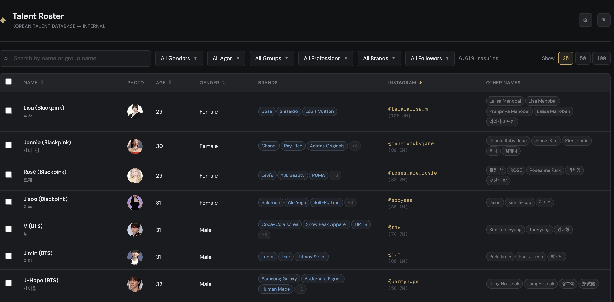
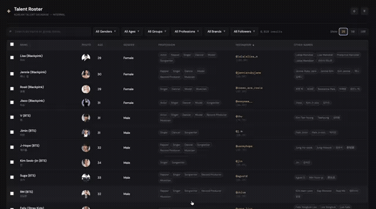
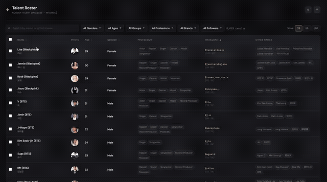
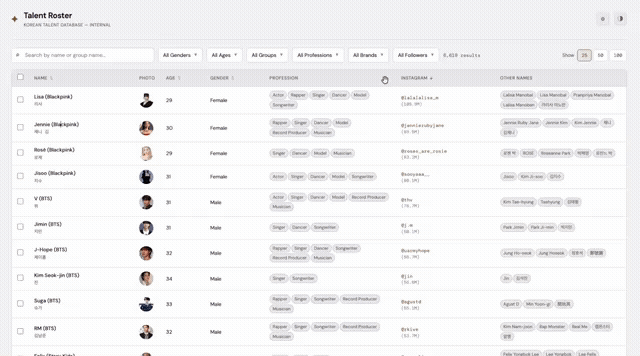

# Talent Search Platform


A talent search and export tool built for a marketing consultancy. Staff search and filter a database of 6,619 Korean entertainment talents by name, group, profession, brand affiliation, and follower count, then export a branded PowerPoint shortlist in one click. Built and shipped solo, from requirements to production.

---

## Screenshots

### Search & filter

<table>
<tr>
<td width="65%">

</td>
<td width="35%" valign="top">
<br/><br/>
<strong>6,619 talents</strong> with server-side filtering by name, group, profession, brand affiliation, and follower range. Columns are sortable and togglable; results paginate without reloading.
</td>
</tr>
</table>

### Talent detail

<table>
<tr>
<td width="50%" valign="top">
<strong>Full profile in one modal.</strong> Identity, career history, social accounts with follower counts, and brand affiliations grouped by year. Each brand affiliation shows its confidence level and links to its source — high-confidence entries are sourced from brand PR or major outlets; medium from a single credible source.
</td>
<td width="50%">

</td>
</tr>
</table>

### Export to PowerPoint

<table>
<tr>
<td width="50%">

</td>
<td width="50%" valign="top">
<strong>Select, preview, download.</strong> Choose talents from the roster, set a brand-confidence threshold (high only or include medium), preview the cards against the deck backdrop, and download a branded <code>.pptx</code> in one click. The file is assembled server-side by grafting data slides into the team's own PowerPoint template.
</td>
</tr>
</table>


---

## The brief

The team was building talent proposals manually — copying data from Wikipedia, fan sites and Instagram, then laying it out in PowerPoint one slide at a time. The brief: build an internal search tool backed by a pre-enriched database, so staff can filter and shortlist in seconds and export a presentation-ready deck in one step.

**Key constraints I had to design around:**

- **No single reliable source** for talent data: group membership, brand deals and follower counts each come from different APIs and sites with inconsistent coverage
- **Template ownership**: the team's PowerPoint template contains their branding, fonts and layouts — the tool had to write *into* their file, not replace it
- **Data provenance**: everything in the database comes from public sources, and each photo and brand claim carries its own provenance (see [Data sources & attribution](#data-sources--attribution)). The team's branded PowerPoint template is not included; the repo ships a neutral stand-in

---

## Architecture

```
Python pipeline (offline)       Supabase (PostgreSQL)          Next.js app (Vercel)
──────────────────────────  ──► ──────────────────────  ──►   ──────────────────────────────
Wikidata harvest                normalized schema:             server-side search, filter,
  ~16,400 records                 talents                      sort, paginate via the view
Bright Data follower counts       social_accounts
Anthropic API brand               brands                 ──►   Export route (server-only key)
  enrichment (~5,800)             talent_brands                PptxGenJS renders slides
Idempotent upsert on              …                            jszip grafts into deck
  Wikidata ID               ──►  talents_search view           template
Checkpoint / resume                (flattens joins)            streams file to browser
Circuit breaker
103 pytest tests
```

Two separate concerns, deployed independently: the pipeline is offline, runs on demand, and never serves user traffic. The Next.js app is read-only against the database and holds no data itself.

---

## Key decisions

### Schema: a flattened view instead of joins in the app

Talents, social accounts, brand affiliations and groups live in separate normalized tables. Rather than repeating complex joins in every query — and risking drift between pages — I created a `talents_search` view that the app always reads from. This keeps app queries simple, lets me change the underlying schema without touching app code, and makes it straightforward to add filters later.

### Export: jszip + PptxGenJS instead of a from-scratch template

The team's PowerPoint template contains custom slide masters, corporate fonts and branded layouts. Recreating that in code would be fragile and would drift every time they updated the file. The approach: PptxGenJS renders the talent data into slides, then jszip unpacks both the generated file and the template, grafts the data slides into the template's ZIP archive, and repackages. The team updates their `.pptx` file; the tool picks it up automatically.

### Export route: server-side only, service key never reaches the browser

The export route re-fetches full talent records using the Supabase service key — fields not sent to the browser for performance are included in the export. Keeping that key server-only was a hard requirement; it also means the export is always fresh, regardless of when the table was last loaded.

### Data quality: discovering and fixing the group-membership gap

Midway through building the pipeline I noticed that many music groups were absent from the dataset — Wikidata's coverage of group membership is inconsistent. I scoped a targeted fix: query Wikidata for all music groups, fetch each group's member list, and upsert the individuals. This expanded the dataset from 5,775 to 6,619 talents. The fix required adding circuit-breaker logic so partial failures during the member expansion couldn't corrupt existing records.

### Brand confidence: source-backed, not assumed

The Anthropic API enrichment step extracts brand affiliations from web sources. Rather than treating all results equally, each affiliation is stored with a confidence level based on whether it came from a verified PR source, a major outlet, or a secondary reference. The export UI exposes a "High only / Include medium" toggle so staff can control what goes into the deck. Low-confidence affiliations appear in the detail view for reference but are excluded from exports by default.

### Access control: invite-only, and enforced in the database

The tool is internal, so access is by invitation. Users sign in with a **magic link**: they enter their email, and if it is on the invite list Supabase emails them a one-time link. Sign-ups are disabled, and the login form shows the same message whether or not an email is registered, so the list cannot be probed.

The login screen alone would not protect anything, because the Supabase anon key ships in the browser bundle and anyone can call the REST API directly. So the real enforcement is lower down:

- **Row Level Security** is on for every table, with a read policy for signed-in users only. The `talents_search` view is `security_invoker`, so it obeys those policies instead of bypassing them.
- **The export route validates the session server-side.** It uses the service key, which bypasses RLS, so it checks the caller's access token with `auth.getUser()` and returns 401 otherwise.
- **The client-side redirect is only UX.** It stops signed-out users seeing an empty table; it is not the security layer.

I verified it from the outside: an anonymous `curl` against the REST endpoint returns no rows, and an unauthenticated `POST /export/pptx` returns 401.

---

## Data sources & attribution

The data is the core of this project, so here is where each piece comes from.

| Data | Source | How it is handled |
|---|---|---|
| Identity, birth year, groups, professions | [Wikidata](https://www.wikidata.org/) (CC0) | Harvested via SPARQL; group membership expanded per group; idempotent upsert on Wikidata ID |
| Photos | [Wikimedia Commons](https://commons.wikimedia.org/) via Wikidata property P18 | **Linked, never rehosted.** Each image keeps its own licence (CC BY, CC BY-SA or public domain); author and licence are on the image's Commons page |
| Gap-fill profiles | Kprofiles | Used only for members missing from Wikidata. A Kprofiles photo is a placeholder, and Wikidata overwrites it when an image exists |
| Follower counts | Public Instagram profile data via Bright Data | Collected by the pipeline and cleaned before load |
| Brand affiliations | Web sources, extracted with the Anthropic API | AI-generated, not verified fact. Every affiliation stores its `source_url` and a confidence level |

**Provenance is stored, not assumed.** `talents.photo_source` records where each image came from (`wikidata`, `kprofiles` or `manual`), and every brand affiliation links to its source in the detail modal.

The talent names, group names and brand names shown belong to their respective owners. This project is not affiliated with or endorsed by any of them. If you are a rights holder and want something removed, open an issue.

---

## Data coverage

- **~16,400** records harvested from Wikidata, normalised and de-duplicated into **6,619 talents**
- Group-membership gap fixed by expanding member lists per group: **5,775 to 6,619** talents
- **~5,800** talents run through brand enrichment, each affiliation source-linked and confidence-scored
- Pipeline covered by **103 pytest tests**, with checkpoint/resume and a circuit breaker for repeated API failures

---

## Running locally

The repo is a monorepo: [`frontend/`](frontend/) is the Next.js app and [`pipeline/`](pipeline/) is the offline Python pipeline. Both read from the same Supabase database, defined in [`schema.sql`](schema.sql).

### Frontend

**Requirements:** Node.js 18+ and a Supabase project with [`schema.sql`](schema.sql) applied.

```bash
git clone https://github.com/heidi1105/talent-filtering-demo.git
cd talent-filtering-demo/frontend
cp .env.example .env.local    # fill in your Supabase URL and keys
npm install
npm run dev
```

Open [http://localhost:3000](http://localhost:3000).

| Variable | Where it's used |
|---|---|
| `NEXT_PUBLIC_SUPABASE_URL` | Browser and server queries |
| `NEXT_PUBLIC_SUPABASE_ANON_KEY` | Browser-side Supabase client |
| `SUPABASE_SERVICE_KEY` | Export route only. Server-side, never `NEXT_PUBLIC_` |

Auth setup in Supabase: disable **Allow new users to sign up**, invite your users by email, and add `http://localhost:3000` to **Authentication, URL Configuration, Redirect URLs**.

### Pipeline

**Requirements:** Python 3.10 and [Pipenv](https://pipenv.pypa.io/).

```bash
cd pipeline
pipenv install --dev
cp .env.example .env          # DATABASE_URL, ANTHROPIC_API_KEY, Bright Data credentials
pipenv run pytest             # 103 tests
```

The numbered scripts (`00_` to `07_`) run in order and are idempotent, so a re-run never duplicates rows. Enrichment runs live under [`pipeline/enrichment/`](pipeline/enrichment/).

> **Demo note:** This repo contains the app code, schema and pipeline. It does not include a database dump. To populate your own Supabase project, run the pipeline or seed it manually.

---

## Project structure

```
schema.sql                      full schema and the talents_search view
frontend/                       Next.js 14 app (App Router, TypeScript)
  app/
    page.tsx                    main talent roster page (auth-guarded)
    login/page.tsx              magic-link sign-in
    export/
      page.tsx                  export preview and selection
      pptx/route.ts             POST route: verifies the session, builds and streams the .pptx file
  components/
    auth/AuthProvider.tsx       session context (useAuth)
    talent-table/               table, column config, filter sheet, sort, pagination
      cells/                    brand pills, social links, copy-id, remarks
      filters/                  age range, follower range, multi-select dropdowns
    export/
      ExportCardGrid.tsx        export preview cards
      TalentCard.tsx            per-talent card with brand confidence display
  hooks/
    useTalentQuery.ts           server-side query with filter params
    useTalentFilters.ts         filter state management
    useColumnVisibility.ts      per-session column config
  lib/
    supabaseClient.ts           browser client (anon key)
    supabaseServerClient.ts     server client (service key, never sent to browser)
    database.types.ts           generated from Supabase schema
    pptxExport.ts               PptxGenJS slide generation
    pptxTemplate.ts             jszip grafting into the team's .pptx template
    talentDisplay.ts            display formatting utilities
  reference/
    pptx_template.pptx          neutral stand-in for the team's branded template
pipeline/                       offline Python pipeline
  00_ to 07_*.py                seed, normalise, load, enrich and backfill stages
  enrichment/
    brands/                     Anthropic API brand enrichment
    followers/                  Bright Data follower counts
  seed/                         group-coverage comparison reports
  tests/                        103 pytest tests
docs/screenshots/               README images
```
